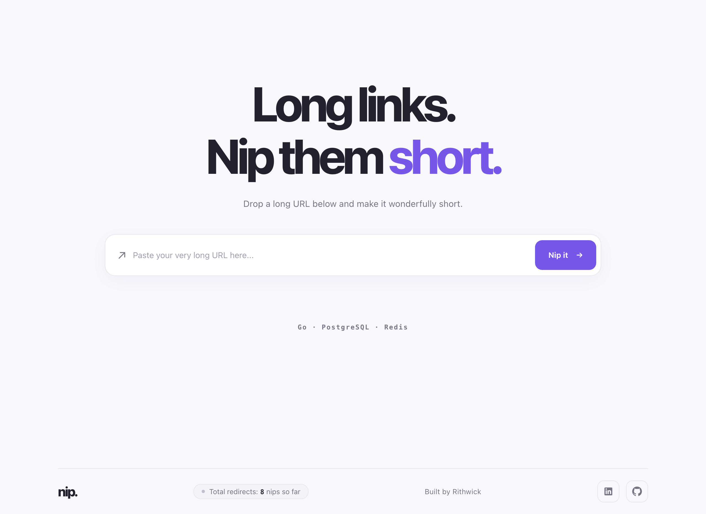
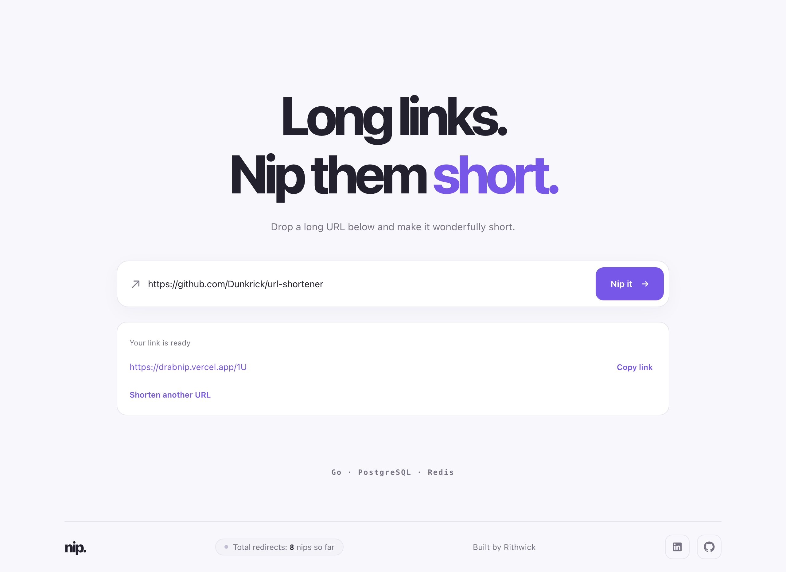

# Nip — Frontend

The web client for [Nip](https://drabnip.vercel.app), a fast and minimal URL shortener built with React, TypeScript, and Vite.

Live demo: [drabnip.vercel.app](https://drabnip.vercel.app)





---

## Table of Contents

- [Overview & Philosophy](#overview--philosophy)
- [Design Decisions & Aesthetic](#design-decisions--aesthetic)
- [Architecture & Folder Structure](#architecture--folder-structure)
- [Core Engineering Decisions](#core-engineering-decisions)
  - [1. Feature-Driven Structure over Global State](#1-feature-driven-structure-over-global-state)
  - [2. Robust API Client & Error Boundary Handling](#2-robust-api-client--error-boundary-handling)
  - [3. Visibility-Aware Polling & Live Counter Animations](#3-visibility-aware-polling--live-counter-animations)
  - [4. Accessibility & Inclusive Interactions](#4-accessibility--inclusive-interactions)
  - [5. Reverse-Proxy Rewrites over Cross-Origin Requests](#5-reverse-proxy-rewrites-over-cross-origin-requests)
- [Tech Stack](#tech-stack)
- [Local Development](#local-development)
  - [Prerequisites](#prerequisites)
  - [Environment Configuration](#environment-configuration)
  - [Development Server](#development-server)
  - [Linting & Production Build](#linting--production-build)

---

## Overview & Philosophy

The Nip frontend was crafted around a single core principle: **purposeful minimalism**. 

URL shorteners are utility tools where speed, clarity, and visual feedback matter most. Rather than cluttering the user experience with multi-section marketing landing pages or unnecessary navigation bars, the application presents a focused, single-viewport interface that lets visitors paste a URL and generate a short link in one click.

---

## Design Decisions & Aesthetic

1. **Bespoke Design System in Vanilla CSS**:
   - Rather than pulling in heavyweight UI component libraries or Tailwind, we used clean, tailored Vanilla CSS built on top of native CSS custom properties (`--bg: #F8F7FC`, `--surface: #FFFFFF`, `--accent: #7657E8`, `--text: #24212E`, `--muted: #777383`, `--border: #E8E5EF`).
   - Full control over cascading variables, fluid type curves, and micro-interactions with zero CSS bundle bloat.

2. **Fluid Typography & Responsive Viewports**:
   - Responsive scaling uses CSS `clamp()` (e.g. `clamp(48px, 7vw, 88px)` for the hero title) to deliver impact across all screen dimensions without layout shifts.
   - Screen sizing uses `100svh` (small viewport height) to prevent mobile browser URL bar resizing jumps.
   - Breakpoints are tailored for standard mobile devices (`<= 640px`) and ultra-compact viewports (`<= 380px`).

3. **Subtle Micro-Interactions**:
   - Gentle lift on the action button (`transform: translateY(-1px)`).
   - Live activity pulsing dot and pill animation when the aggregate redirect counter increments.
   - Dynamic copy state toggle with automatic 2-second timeout reset.

---

## Architecture & Folder Structure

The frontend adheres to a feature-driven layout that groups related business logic, API calls, and custom hooks together:

```text
frontend/
├── public/                 # Static assets (favicons, SVG icons)
├── src/
│   ├── assets/             # Brand graphics and iconography
│   ├── components/         # Pure, reusable presentational components
│   │   ├── UrlForm.tsx           # Controlled input form with loading & submit states
│   │   └── ShortUrlResult.tsx    # Result display card with clipboard copy logic
│   ├── config/             # Runtime environment configuration & validation
│   │   └── env.ts                # Validates VITE_API_BASE_URL
│   ├── features/           # Feature slices encapsulating state and domain logic
│   │   ├── shorten/              # URL shortening domain
│   │   │   ├── api.ts            # POST /api/v1/urls service
│   │   │   ├── types.ts          # Request & response contracts
│   │   │   └── useShortenUrl.ts  # Form state, trimmed validation, & loading flags
│   │   └── stats/                # Global redirect metrics domain
│   │       ├── api.ts            # GET /api/v1/stats service
│   │       └── useStats.ts       # Polling, visibility throttling, & pulse trigger
│   ├── lib/                # Shared utilities and network abstractions
│   │   └── api-client.ts         # Fetch wrapper with typed ApiError handling
│   ├── App.css             # Page layout, responsive breakpoints, & animation keyframes
│   ├── App.tsx             # Root assembly, semantic document structure, & footer
│   ├── index.css           # Global tokens, color theme, reset, & accessibility styles
│   └── main.tsx            # Application entry point
├── vercel.json             # Vercel reverse proxy rewrites to Cloud Run Go API
├── vite.config.ts          # Vite build and plugin configuration
└── package.json            # Scripts and dependencies
```

---

## Core Engineering Decisions

### 1. Feature-Driven Structure over Global State

Given the targeted scope of the application, incorporating an external state management library (such as Redux, Zustand, or Recoil) would introduce unnecessary overhead. Instead:
- State is partitioned into custom hooks (`useShortenUrl` and `useStats`).
- Presentational components (`UrlForm`, `ShortUrlResult`) remain stateless and driven strictly by props, making them straightforward to test, refactor, and reason about.

### 2. Robust API Client & Error Boundary Handling

Network communication is centralized in [`lib/api-client.ts`](src/lib/api-client.ts) through a typed wrapper over native `fetch`:
- **Custom `ApiError` Class**: Attaches HTTP status codes directly to error instances for fine-grained handling.
- **Specific Status Mapping**:
  - `429 Too Many Requests`: Informs users of the 100 req/min rate limit (*"Too many requests. Please wait a minute before trying again."*).
  - `400 Bad Request`: Prompts for URL validation (*"Please enter a valid URL."*).
  - `5xx Server Errors`: Shows graceful degradation messages (*"Our server is having trouble. Please try again shortly."*).
  - **Network Failures**: Catches offline drops or CORS blocks (*"Unable to reach the server. Check your connection and try again."*).
- **Concurrency & Double-Submit Protection**: The form disables inputs and the submit button while `isLoading` is true, preventing duplicate submissions or accidental stress on the backend.

### 3. Visibility-Aware Polling & Live Counter Animations

The live redirect counter (`useStats`) provides real-time feedback without abusing client resources:
- **Interval Polling**: Polls `GET /api/v1/stats` on a 5-second interval.
- **Page Visibility API**: Uses `document.visibilityState === 'visible'` to pause polling when the browser tab is hidden or backgrounded, saving bandwidth and battery.
- **Immediate Focus Re-sync**: Attaches `focus` and `visibilitychange` listeners to immediately refresh metrics as soon as the user returns to the tab.
- **Pulse State Machine**: Compares `newCount > prevCount` to trigger a green glowing pulse (`is-active` class) for 2.2 seconds upon each count increment.
- **Graceful Failure Retention**: Transient network blips preserve the previous count rather than resetting or flickering to empty.

### 4. Accessibility & Inclusive Interactions

- **Accessible Labels**: Offscreen labels (`.sr-only`) ensure screen readers have full context for inputs and status messages.
- **Live Regions**: Uses `role="alert"` for form errors and `role="status"` with `aria-live="polite"` for copy confirmation and redirect counts.
- **Motion Preferences**: Respects `prefers-reduced-motion: reduce` by setting transition and animation durations to `0.01ms`.
- **Keyboard Navigation**: Distinct focus rings (`outline: 3px solid var(--accent); outline-offset: 4px;`) across all interactive buttons, inputs, and links.

### 5. Reverse-Proxy Rewrites over Cross-Origin Requests

In production, frontend assets are hosted on Vercel while the Go API runs on Google Cloud Run. Rather than dealing with cross-origin browser quirks or exposing the Cloud Run domain directly, we configured [`vercel.json`](vercel.json):

```json
{
  "rewrites": [
    {
      "source": "/api/:path*",
      "destination": "https://url-shortener-902490290476.asia-south1.run.app/api/:path*"
    },
    {
      "source": "/:shortCode",
      "destination": "https://url-shortener-902490290476.asia-south1.run.app/:shortCode"
    }
  ]
}
```

**Benefits**:
- **Zero CORS in production**: The browser communicates with the same origin (`drabnip.vercel.app`).
- **Clean vanity short links**: `drabnip.vercel.app/:shortCode` routes directly to the Go server for 302 redirects.
- **Simplified environment config**: `VITE_API_BASE_URL` can point to `http://localhost:8080` during local development or `/` (or relative path) in deployment.

---

## Tech Stack

- **Framework**: React 18
- **Language**: TypeScript (strict mode)
- **Bundler & Dev Server**: Vite 6
- **Styling**: Vanilla CSS (CSS Variables, Flexbox, Fluid Clamps)
- **Deployment**: Vercel

---

## Local Development

### Prerequisites

- [Node.js](https://nodejs.org/) (v18 or higher recommended)
- [npm](https://www.npmjs.com/)

### Environment Configuration

Create a local environment file in `frontend/.env.local`:

```env
VITE_API_BASE_URL=http://localhost:8080
```

### Development Server

Install dependencies and start the Vite development server:

```bash
npm install
npm run dev -- --port 5175
```

Open [http://localhost:5175](http://localhost:5175) in your browser.

### Linting & Production Build

Check for TypeScript and ESLint errors:

```bash
npm run lint
```

Build the optimized production bundle:

```bash
npm run build
```
